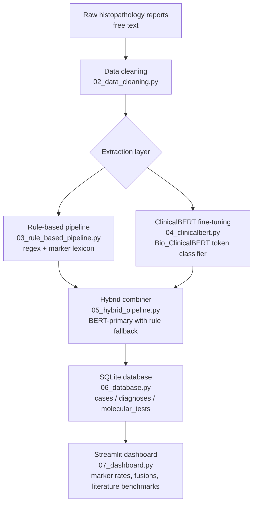

# IHC NLP Pipeline for Soft Tissue and Bone Tumour Pathology

**Author:** Fatine Oumlil  
**Degree:** MSc Computer Science

## Project Status

Submitted 11 October 2026 as part of the MSc Computer Science programme at Birkbeck, University of London. All pipeline components are implemented and evaluated. ClinicalBERT fine-tuning complete (8 epochs, overall F1=0.873 on held-out test set on 809 held-out cases).

## Overview

An end-to-end NLP pipeline for extracting structured immunohistochemistry (IHC) and molecular findings from free-text histopathology reports, with a prototype decision-support dashboard for soft tissue and bone tumour pathology.

All processing runs on-premise under institutional data governance and GDPR constraints — no patient data is sent to external APIs or cloud services.

## Pipeline Architecture



## Results

Evaluation on a stratified held-out test set of 809 cases (15% of the 5,389-case ground-truth dataset, withheld from training and model selection). Metrics are micro-averaged across positive and negative marker extraction.

| Pipeline | Pos F1 | Neg F1 | Overall F1 | Evaluation set |
|---|---|---|---|---|
| Rule-based only | 0.737 | 0.854 | 0.803 | Pilot (LMS HG, inflated) |
| Rule-based only | — | — | 0.699 | Full dataset, normalised |
| ClinicalBERT (8 epochs) | 0.870 | 0.874 | **0.873** | Held-out test set, 809 cases |
| ClinicalBERT (8 epochs) | 0.912 | 0.904 | 0.907 | Full dataset (inflated) |
| Hybrid (BERT-primary) | 0.844 | 0.876 | 0.864 | Full dataset, normalised |

ClinicalBERT validation F1 by epoch: 0.897, 0.913, 0.917, 0.923, **0.924** (peak), 0.923, 0.920, 0.925. Performance plateaued after epoch 5, confirming 8 epochs as sufficient.

Run `python evaluate.py` to reproduce rule-based results. ClinicalBERT inference requires the trained checkpoint in `models/`.

## Structure

```
.
├── 01_data_exploration.py       # Initial dataset analysis
├── 02_data_cleaning.py          # Text preprocessing and normalisation
├── 03_rule_based_pipeline.py    # Rule-based IHC extraction (regex + lexicon)
├── 04_clinicalbert.py           # Bio_ClinicalBERT fine-tuning (token classification)
├── 05_hybrid_pipeline.py        # BERT-primary hybrid combiner
├── 06_database.py               # Database schema and import scripts
├── 07_dashboard.py              # Streamlit decision-support dashboard
├── evaluate.py                  # Evaluation script (precision/recall/F1 vs ground truth)
├── marker_utils.py              # Shared marker normalisation utilities
├── analysis_by_diagnosis.py     # Per-diagnosis analysis
├── literature_references.md     # IHC profiles from published literature
├── requirements.txt             # Python dependencies
└── NOTES.md                     # Development decisions and methodology notes
```

## Setup

```bash
pip install -r requirements.txt
```

Run the dashboard:

```bash
streamlit run 07_dashboard.py
```

Run evaluation:

```bash
python evaluate.py
```

Train ClinicalBERT (requires GPU):

```bash
python 04_clinicalbert.py --train --eval --full --epochs 8
```

## Engineering Notes

**On-premise constraint:** Institutional data governance and GDPR prohibit sending patient data to external services. All inference runs locally; the HuggingFace model weights are downloaded once and stored in `models/` (excluded from version control).

**FUSE filesystem:** The database lives on a network-mounted filesystem. SQLite journal mode is set to `MEMORY` with `synchronous=OFF` to bypass POSIX locking limitations on FUSE mounts.

**Idempotent imports:** All data import scripts follow a delete-then-reinsert pattern keyed on source file, so re-running never creates duplicates.

**Normalisation:** A shared `normalize_molecular()` function reconciles inconsistent gene nomenclature (aliases, fusion notation variants, protein-change formats) across both the ETL layer and the dashboard query logic, ensuring consistent grouping without losing the original raw value.

## Data

Patient data is not included in this repository. The pipeline expects:
- A SQLite database at `data/ihc_database.db`
- Source report files in `data/`

The `data/` directory and all `.xlsx` files are excluded from version control via `.gitignore`.
