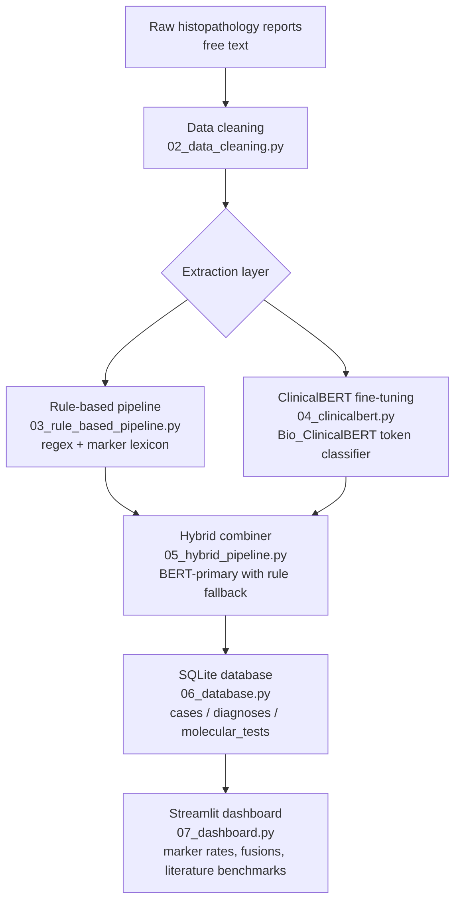

# IHC NLP Pipeline for Soft Tissue Tumour Pathology

**Author:** Fatine Oumlil  
**Degree:** MSc Computer Science

## Project Status

Final MSc project in progress. Final submission scheduled for October 2026. Core ETL, database, NLP, and dashboard components are implemented; evaluation runs (8 and 16 epoch training), results analysis, and dissertation write-up are being finalised.

## Overview

An end-to-end NLP pipeline for extracting structured immunohistochemistry (IHC) and molecular findings from free-text histopathology reports, with a prototype decision-support dashboard for soft tissue tumour pathology.

All processing runs on-premise under institutional data governance and GDPR constraints — no patient data is sent to external APIs or cloud services.

## Pipeline Architecture



## Results

Evaluation against a manually labelled ground truth set (positive and negative IHC outcomes per case):

| Pipeline | Precision | Recall | F1 |
|---|---|---|---|
| Rule-based only | — | — | — |
| ClinicalBERT (8 epochs) | — | — | — |
| ClinicalBERT (16 epochs) | — | — | — |
| Hybrid (BERT-primary) | — | — | — |

*Results to be updated after final training runs. Run `python evaluate.py` to reproduce.*

## Structure

```
.
├── 01_data_exploration.py       # Initial dataset analysis
├── 02_data_cleaning.py          # Text preprocessing and normalisation
├── 03_rule_based_pipeline.py    # Rule-based IHC extraction (regex + lexicon)
├── 04_clinicalbert.py           # Bio_ClinicalBERT fine-tuning (token classification)
├── 05_hybrid_pipeline.py        # BERT-primary hybrid combiner
├── 06_database.py               # Database schema and import scripts
├── 07_dashboard.py              # Streamlit decision-support dashboard
├── evaluate.py                  # Evaluation script (precision/recall/F1 vs ground truth)
├── marker_utils.py              # Shared marker normalisation utilities
├── analysis_by_diagnosis.py     # Per-diagnosis analysis
├── literature_references.md     # IHC profiles from published literature
├── requirements.txt             # Python dependencies
└── NOTES.md                     # Development decisions and methodology notes
```

## Setup

```bash
pip install -r requirements.txt
```

Run the dashboard:

```bash
streamlit run 07_dashboard.py
```

Run evaluation:

```bash
python evaluate.py
```

Train ClinicalBERT (requires GPU):

```bash
python 04_clinicalbert.py --train --eval --full --epochs 8
```

## Engineering Notes

**On-premise constraint:** Institutional data governance and GDPR prohibit sending patient data to external services. All inference runs locally; the HuggingFace model weights are downloaded once and stored in `models/` (excluded from version control).

**FUSE filesystem:** The database lives on a network-mounted filesystem. SQLite journal mode is set to `MEMORY` with `synchronous=OFF` to bypass POSIX locking limitations on FUSE mounts.

**Idempotent imports:** All data import scripts follow a delete-then-reinsert pattern keyed on source file, so re-running never creates duplicates.

**Normalisation:** A shared `normalize_molecular()` function reconciles inconsistent gene nomenclature (aliases, fusion notation variants, protein-change formats) across both the ETL layer and the dashboard query logic, ensuring consistent grouping without losing the original raw value.

## Data

Patient data is not included in this repository. The pipeline expects:
- A SQLite database at `data/ihc_database.db`
- Source report files in `data/`

The `data/` directory and all `.xlsx` files are excluded from version control via `.gitignore`.
